# Windows Remote Admin (Node.js 版)

便携式 Windows 远程管理工具：通过浏览器对服务器执行 PowerShell 命令、管理文件、编辑文本、实时监控日志。

技术栈：**Node.js + Fastify v5 + HTMX + Tabler (Bootstrap 5)**，无需数据库、无需注册服务，解压即用。

## 为什么选择本项目

一款面向**企业级 Windows 服务器（访问受限环境）**的自托管远程管理工具。企业服务器往往身处内网隔离区、安全基线严苛：RDP 3389 默认封禁、禁止安装未审批的 C/S 客户端、无法访问公网下载工具，而查日志、改配置、重启服务、排查端口占用这些日常运维却天天要做。本项目把高频运维搬进浏览器——**只需在防火墙放行一个 TCP 端口**：

| 企业受限场景痛点 | 本项目对策 |
|----------------|-----------|
| RDP 3389 被封禁，开远程桌面需层层审批 | 浏览器直访单端口即可运维，可置于 Nginx / Caddy 反代后终结 HTTPS；`/setup` 部署向导内置 Windows 防火墙放行检测与 GCP GCE MIG 防火墙 tag 指引 |
| 禁止安装未审批软件，C/S 工具装不上 | 目录分发、解压即用，无需数据库、无需注册服务（可选 NSSM 注册为系统服务，开机自启、崩溃自拉起） |
| 隔离网络连不上 CDN / 外网 | Tabler / HTMX / 图标字体全部本地化，运行期零外网请求 |
| 运维操作分散在多种工具之间 | PowerShell 控制台、文件管理（上传/下载/压缩/预览）、文本编辑、日志实时监控与 Grep 搜索、服务启停、端口占用排查、事件日志查询、本地用户管理，一站式覆盖 |
| 合规要求操作可追溯 | 所有写操作二次确认（预览将执行的 PowerShell 命令）并逐条审计（操作人 / IP / 参数 / 结果） |
| 多人共用需要权限分级 | 只读账号角色（写操作前后端双重拦截）；`pathWhitelist` 路径白名单、上传/解压上限、命令超时等安全边界按需收紧 |

一句话总结：**为"装不了软件、开不了远程桌面、连不上外网"的 Windows 服务器，提供一个解压即用、单端口可达、操作全审计的浏览器端运维面板。**

> **生产验证**：本项目已在 GCP GCE 线上环境以 immutable 方式部署并稳定应用（MIG 滚动替换 + 防火墙 tag 单端口放行，见 [`/setup`](#界面预览) 内置的 GCP 配置指引），实际支撑日常运维。更多实用功能持续更新中，欢迎大家提交 PR 与使用建议（见文末[参与贡献](#参与贡献)）。

## 快速开始

1. 安装 [Node.js](https://nodejs.org/) **22 或更高版本**（LTS 支持线，建议 LTS 22）
2. 双击 `Run.cmd`（首次运行会自动安装依赖并复制静态资源）
3. 浏览器访问 <http://127.0.0.1:12306>

> 也可以用命令行：`npm install` → `npm start`。
> `Build.cmd` 用于构建校验：安装/同步依赖、复制静态资源、全量语法检查。
> `Pack.cmd`（或 `npm run pack:code`）用于生成分发压缩包，见下方"分发打包"。

## 分发打包（code & web only）

面向"源码 + 页面"的轻量分发场景，产物不携带依赖与运行数据：

```bash
npm run pack:code    # 或双击 Pack.cmd
```

- 产物：`dist/windows-remote-admin-code-web-v<版本>.zip`（约 100 KB）
- **包含**：`server.js`、`package.json` / `package-lock.json`、`config.default.json`、`.env.example`、`README.md`、`Run.cmd` / `Build.cmd` / `Pack.cmd`、`src/`、`views/`、`scripts/`、`public/` 本地文件（app.css / app.js）
- **不包含**：`node_modules`、vendor 静态资源（Tabler / HTMX / 图标字体，由 postinstall 自动复制）、`logs/`、`data/`、`screencap/`、`dist/`、本机 `config.json`
- 接收方解压后双击 `Run.cmd` 即可：首次运行自动 `npm install`（postinstall 同步静态资源）并启动服务

**部署包（对接 `/deploy` 简易部署）**：

```bash
npm run pack:deploy    # 产物：dist/wra-deploy-v<版本>.zip
```

- 与 `pack:code` 的区别：仅含部署白名单条目（`package.json` / `server.js` / `src` / `views` / `scripts` / `public`），且 `public/` **全量包含 vendor 静态资源**（原地更新不执行 `npm install`，静态资源必须随包携带）
- 打包完成后打开 `/deploy` 页面上传该文件即可，产物文件名中的版本号即建议的部署版本号

**默认账号：** `admin` / `admin123`（首次登录后请立即修改，见下方"账号管理"）

## 功能列表

| 模块 | 说明 |
|------|------|
| 系统概览 `/dashboard` | OS / CPU / 内存 / 磁盘 / 运行时间 / 进程 Top10，自动轮询刷新 |
| PowerShell 控制台 `/console` | 连续会话（cd / 变量跨命令保留）、命令自动补全（Tab 接受 + ↑↓ 切换）、命令历史（↑↓ 前缀搜索 + 历史面板回填）、超时保护、执行耗时显示，终端 : 任务面板 7:3 布局、高度可拖拽调节（双击恢复自适应）、字号随视口缩放（34" 带鱼屏 ~ 15" 笔记本）；后台长任务（开关内嵌终端卡，勾选后「执行」即提交；SSE 实时输出推送、超时预算 10 分钟~24 小时、脚本模式 .ps1、随时终止） |
| 文件管理 `/files` | 目录浏览、多选、上传（带进度）、下载/打包下载、zip 压缩/解压、新建/重命名/删除、类型感知预览（文本分页/图片/zip 条目/二进制）、收藏夹 |
| 文本编辑器 `/editor` | 在线编辑保存、行号/行列状态、Ctrl+S 保存、自动 `.bak` 时间戳备份 |
| 日志监控 `/logs` | 通配符过滤、关键词高亮、SSE 实时 tail、自动跟踪新文件 |
| 服务管理 `/services` | 服务列表/搜索、单服务与批量启停/重启/禁用（复选框多选，单批上限 20）、启动类型切换，全部操作弹确认框（预览将执行的 PowerShell 命令）并逐条审计，只读账号仅可查看 |
| 任务计划 `/tasks` | 模拟任务计划程序库管理：全量计划任务列表（含程序命令行、上次运行/结果/下次运行），文件夹 + 状态（就绪/运行中/排队/已禁用）+ 名称模糊筛选；admin 可运行/终止/启用/禁用/删除任务（确认框预览命令并审计），XML 全保真编辑（含描述/程序/参数/起始于/权限快速编辑表单，即时写回 XML），结构化新建任务（5 种触发器 + 运行身份，文件夹自动创建）；`\Microsoft\` 系统任务操作时红色警示，只读账号仅可查看 |
| 端口/网络 `/net` | TCP/UDP 连接列表（本地/远程地址、状态、PID、占用进程完整命令行），状态筛选 + 关键字搜索（端口/PID/进程/IP/命令行），admin 可结束占用进程释放端口（确认框预览 `Stop-Process` 命令 + 审计），系统关键进程（PID 0/4/8）拒绝操作，只读账号仅可查看 |
| 进程管理 `/process` | 全量运行进程列表，内存/CPU 占用率（1.5 秒差分采样，小字附累计 CPU 时间）/PID/名称排序，关键字搜索（进程名/PID/路径），admin 可结束进程释放资源（确认框预览 `Stop-Process` 命令 + 审计），系统关键进程（PID 0/4/8）拒绝操作，只读账号仅可查看 |
| 事件查看器 `/events` | Windows 事件日志查询（System/Application/Security），按级别（严重/错误/警告/信息）与起止日期时间筛选，关键字搜索消息/来源/事件 ID，支持屏蔽关键字（逗号分隔，隐藏高频噪音事件），最新在前，单次最多 500 条，只读功能 |
| 本地用户 `/users` | 本地账户列表（启用/锁定状态、上次登录、密码最后设置），admin 可解锁（`Unlock-LocalUser`）、启用已禁用账户（Guest 禁止启用，UI 隐藏 + 后端 403）、重置密码（`net user`，密码 env 注入不落日志），全部操作确认框 + 命令预览（密码打码）+ 独立审计，只读账号仅可查看 |
| 环境变量 `/env` | Machine / User 作用域环境变量管理：列表、搜索、新增/编辑/删除（`SetEnvironmentVariable`，值 env 注入不落日志）；全员可用的「查看」只读弹窗（避免误触编辑，只读账号仅此操作）；Path 等分号分隔值支持 Windows 风格列表编辑器（拆分行编辑后一键回写）；30 个系统关键变量（Path/ComSpec/OS 等）禁止删除（UI 置灰 + 后端 400 双重拦截）；敏感变量（含 pass/token/key 等）值自动打码，查看走 `/env/reveal`（admin + 审计），编辑打开时按需回填 |
| 证书管理 `/certs` | LocalMachine 常用存储区（My/WebHosting/Root/CA/TrustedPeople/TrustedPublisher）证书浏览：主题/颁发者/指纹/有效期（过期红 / 30 天内橙 / 正常绿）/SAN/私钥标识，状态筛选 + 关键字搜索；详情弹窗（算法/密钥位长/EKU/序列号）；admin 可上传证书（.cer/.crt/.pem 公钥免密码、.pfx/.p12 需导入密码，密码 env 注入不落日志）、导出 .cer/.pem/.pfx（pfx 走一次性下载 token + 随机密码仅展示一次）与删除证书（确认框预览 `Remove-Item` 命令 + 审计），只读账号仅可查看 |
| 设置 `/settings` | 快速访问目录配置（即时生效） |
| 部署向导 `/setup` | NSSM 服务安装说明 + 本机环境检测（Node/NSSM/服务状态）、Windows 防火墙配置文件与端口放行规则检测、防火墙放行命令与 GCP GCE MIG VPC 防火墙 tag 配置指引，命令一键复制 |
| 简易部署 `/deploy` | 上传 zip 压缩包原地更新程序：预检（结构白名单校验 + 自动剥离 node_modules + 拒绝 data/logs/backups/.env）、确认后自动备份当前版本到 `backups/`（保留最近 5 份）再覆盖解压；重启后若首次启动失败，启动门卫自动回滚到部署前版本；备份列表一键手动回滚（确认框 + 审计）；页面明示压缩包规范与「先在 low environment 多次验证再上 production」风险提示，admin 专属 |
| 全局 | 登录限流、CSRF 防护、会话认证、审计日志、错误兜底页、多语言（英文/简体中文） |

## 更新日志

当前版本：**v2.0.0**（Node.js 版）。完整变更见 [提交历史](https://github.com/moshowgame/windows-remote-admin/commits/main)。

### 2026-11 —— Node.js 版持续迭代
- **2026-11-02**：新增环境变量管理 `/env` 与证书管理 `/certs`：Machine/User 双作用域变量增删改（关键系统变量禁删、敏感值打码 + 按需 reveal 审计、作用域筛选 + 新建跟随筛选 + 已有变量作用域锁定、Path 等分号分隔值支持 Windows 风格列表编辑器），LocalMachine 六大存储区证书浏览（有效期预警、指纹列、SAN/EKU 详情）、证书上传（.cer/.crt/.pem 公钥免密码、.pfx/.p12 需导入密码）、.cer/.pem/.pfx 导出（pfx 走一次性 token，密码仅展示一次）与删除，写操作全部确认框/审计；顺带修复 PowerShell 子进程 PSModulePath 被父进程（PS7）污染导致 `Cert:` 驱动器缺失的底层问题（惠及全部 PS 命令）
- **2026-11-01**：PowerShell 控制台交互升级：内嵌终端式多行输入（Enter 执行 / Shift+Enter 换行，中文输入法友好）、经典 PowerShell 深蓝配色；新增命令自动补全（服务端 Get-Command 全集，Tab 接受 / ↑↓ 切换 / Esc 关闭）与历史前缀搜索（历史面板点击回填）
- **2026-11-01**：新增后台长任务：命令/脚本提交为独立 Job（与交互会话解耦、每用户并发 ≤3），SSE 实时推送输出、超时预算（10 分钟~24 小时）、随时终止，任务历史保留 24 小时；终端 : 任务面板 7:3 布局，终端高度可拖拽调节（localStorage 记忆、双击恢复），任务提交开关（后台任务 / 脚本模式）内嵌终端底部，提示随状态三态切换
- **2026-11-01**：新增简易部署 `/deploy`：上传 zip 原地更新（结构白名单预检 + 自动剥离 node_modules + 拒绝运行时目录）、自动备份（保留 5 份）与一键手动回滚；启动门卫在首次启动失败时自动回滚到部署前版本（端口占用等环境性错误不误判），启动结果落盘并在页面展示（含补写审计），未确认上传包 24h 自动清理，全程审计，admin 专属；配套 `npm run pack:deploy` 一键生成符合规范的部署包（含 vendor 静态资源）

### 2026-10 —— Node.js 版持续迭代
- **2026-10-31**：易用性改进，编辑器新增"返回文件管理"快捷按钮（跳回最后浏览目录）；文件列表单文件目录保持一致最小高度；
- **2026-10-31**：审计日志精简：目录浏览 / 日志查看等纯查看操作与未登录的页面访问不再写审计（仅上传 / 下载 / 保存 / 删除等写类与下载类行为保留），访问日志仍全量记录保证可追溯
- **2026-10-31**：新增任务计划管理 `/tasks`：全量计划任务列表（程序命令行、上次运行/结果/下次运行），文件夹 + 状态 + 名称模糊筛选；运行/终止/启用/禁用/删除（确认框预览命令 + 审计）；XML 全保真编辑 + 快速编辑表单（描述/程序/参数/起始于/权限，即时写回 XML）；结构化新建任务（once/daily/hourly/boot/logon 触发器，任务文件夹 COM 自动创建）；`\Microsoft\` 系统任务操作红色软警示；只读账号仅可查看
- **2026-10-28**：新增进程管理 `/process`：全量进程列表（200+ 进程单次拉取），内存/CPU 占用率/PID/名称排序，关键字搜索（进程名/PID/路径）；CPU 占用率为 1.5 秒差分采样（贴近任务管理器口径），小字附累计 CPU 时间；admin 可结束进程释放资源（确认框预览 `Stop-Process` 命令 + 审计，系统关键进程 PID 0/4/8 保护）
- **2026-10-24**：压缩/打包操作增加二次确认框（条目数 + 文件名预览），避免误触发；新增 NSSM 服务管理脚本（`Service.cmd` 双击菜单 + `scripts/service.ps1`）与 `.env` 自动加载（程序目录基准，不覆盖已有环境变量）；新增部署向导 `/setup`（环境检测、Windows 防火墙放行检测、GCP GCE MIG 防火墙 tag 指引、命令一键复制）；UI 流畅性优化（页面过渡动画、局部刷新加载指示、长列表 sticky 表头、滚动条美化、按钮微交互）；README 界面预览覆盖全部页面截图
- **2026-10-22**：新增本地用户管理 `/users`：账户列表、解锁/启用（Guest 保护）、密码重置（admin 专属，确认框 + 命令预览 + 独立审计）
- **2026-10-21**：新增事件查看器 `/events`（级别/起止时间筛选、关键字搜索、屏蔽关键字）；新增端口/网络视图 `/net`（TCP/UDP 连接 + 占用进程完整命令行，admin 可结束进程释放端口）；明确 Node.js 20+ 版本要求
- **2026-10-20**：多语言支持（英文/简体中文，右上角一键切换）；新增只读账号角色（readonly，写操作前后端双重拦截）
- **2026-10-11**：以 Node.js（Fastify v5 + HTMX）完整重构并发布 2.0；新增系统服务管理 `/services`（单/批量启停、重启、禁用，确认框预览命令、逐条审计）；日志监控新增 GREP 全文件扫描模式；界面视觉升级 2.0

### 2026-05 —— Go 重构尝试

- **2026-05-25 ~ 05-26**：后端以 Go 重写（后为功能生态与迭代效率，最终迁移至 Node.js）

### 2026-02 —— 全新 UI

- **2026-02-15 ~ 02-19**：合并全新界面（非 Vue 的渐进式重构）、更名 WindowsRemoteAdmin、登录流程优化、修复日志/文本浏览器问题、PowerShell 命令参考扩充

### 2025-03 ~ 2025-04 —— Java / Spring Boot 初版

- **2025-04-06**：文件管理器支持自定义路径；执行器新增编码选择与常用命令快速输入；日志浏览器新增查询范围天数限制；审计日志精简（列表/读取类操作不计入）
- **2025-03-27**：日志组件切换 log4j2
- **2025-03-09 ~ 03-11**：新增日志浏览器 LogViewer（文件名通配匹配 + 内容查找）、编辑器更换 CodeMirror5、Shell 修复历史命令/路径问题并新增防抖与可定制审计日志配置、文件管理器文本浏览区域下移
- **2025-03-03 ~ 03-09**：实现文件目录浏览与文本预览、文件下载、TextViewer 优化、登录页与 Landing Page（静态资源本地化）
- **2025-03-02**：项目初始化

## 界面预览

> 界面支持英文 / 简体中文一键切换，以下截图为中文界面。

**登录页**（默认账号 `admin / admin123`）


**系统概览** —— OS / CPU / 内存 / 磁盘 / 运行时间 / 进程 Top10，自动轮询刷新

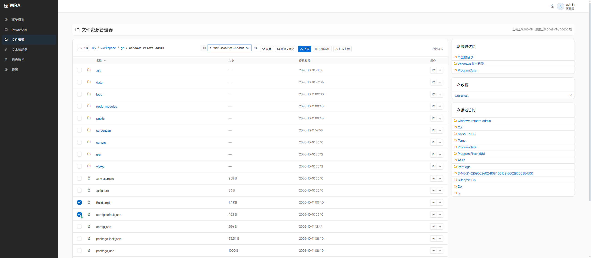

**PowerShell 控制台** —— 连续会话、命令自动补全、历史前缀搜索与历史面板、超时保护、执行耗时显示

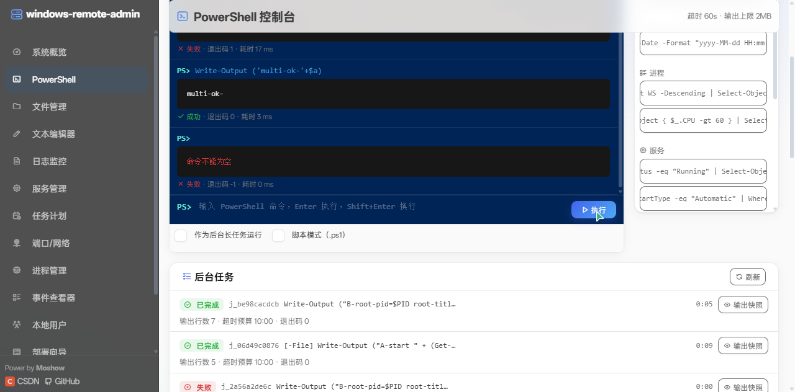

**文件资源管理器** —— 目录浏览、多选批量操作、上传/下载、收藏夹与快速访问


**类型感知文件预览** —— 文本分页 / 图片 / zip 条目 / 二进制元数据，超限与失败直接提示

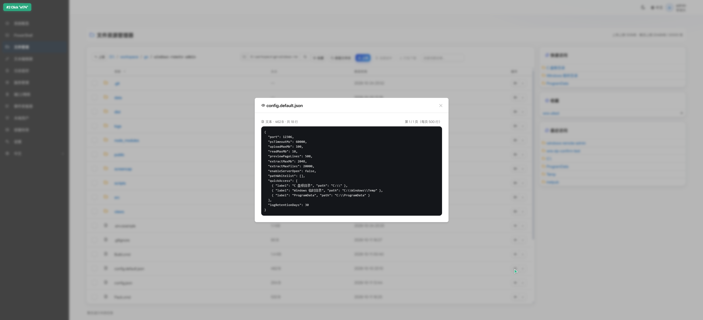

**文本编辑器** —— 行号与行列状态、Ctrl+S 保存、自动 `.bak` 时间戳备份

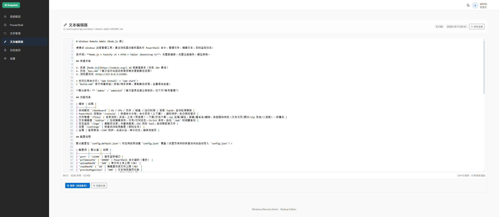

**日志监控** —— 通配符过滤、关键词高亮、Grep 全文件搜索、SSE 实时 tail

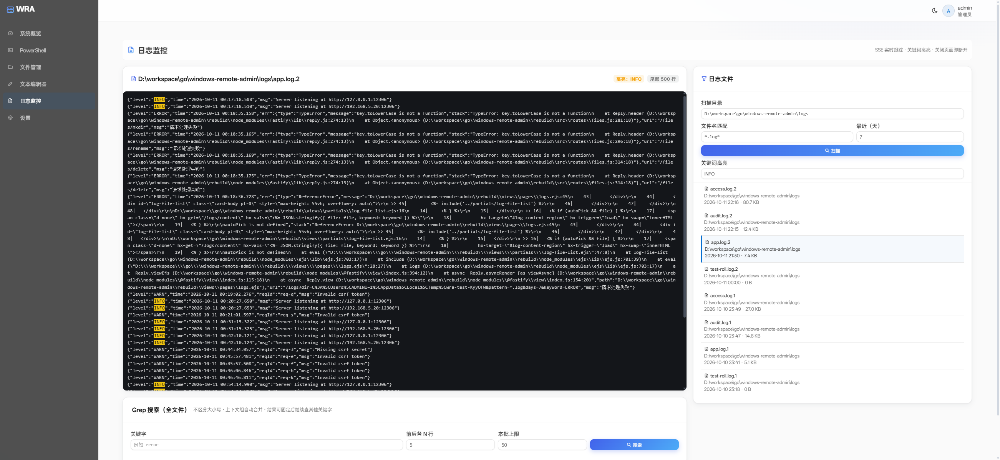

**服务管理** —— 启停 / 重启 / 启动类型切换 / 批量操作，确认框预览命令、操作即审计

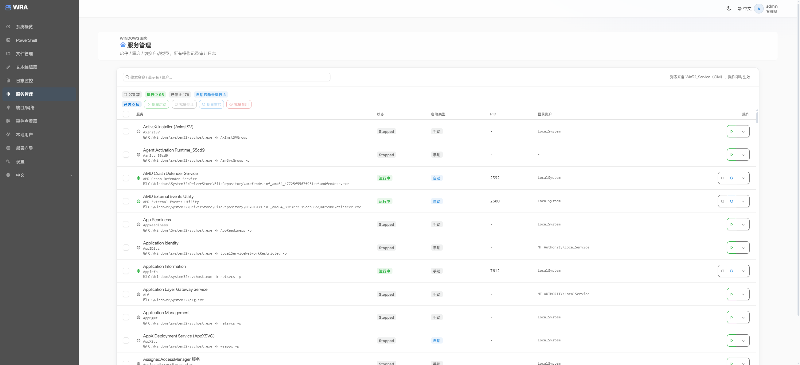

**任务计划** —— 任务计划程序库管理：文件夹/状态/名称筛选、运行/终止/启用/禁用/删除、XML 全保真编辑 + 快速编辑、结构化新建

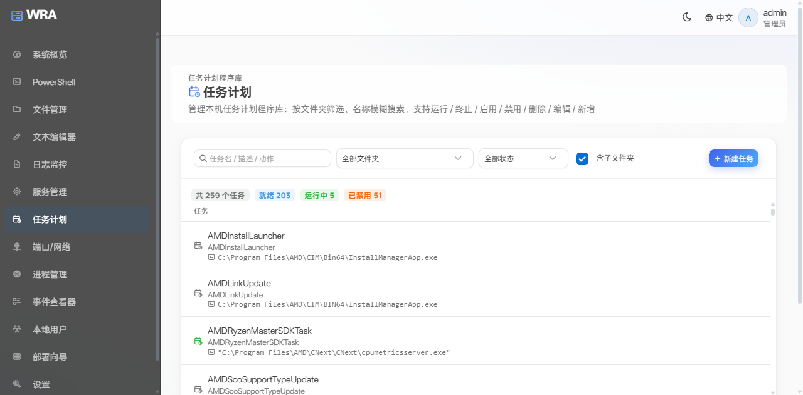

**端口/网络** —— TCP/UDP 连接与占用进程完整命令行、结束进程释放端口，确认框 + 审计

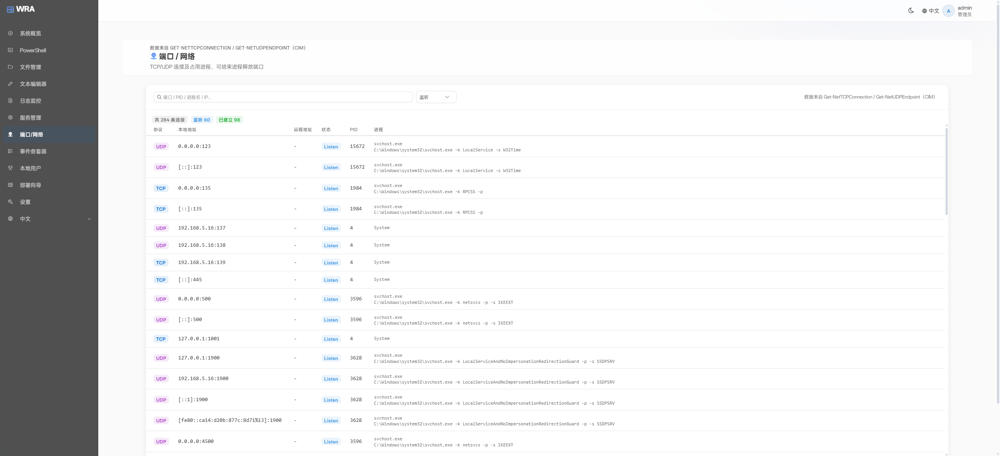

**进程管理** —— 全量进程列表、CPU 占用率（差分采样）/内存排序、结束进程释放资源，确认框 + 审计

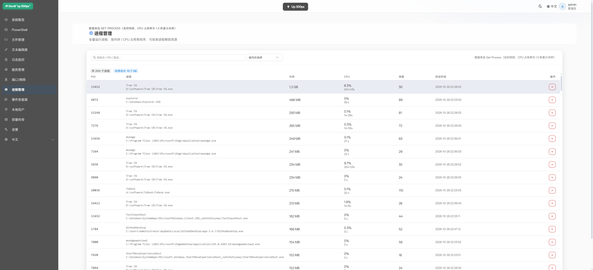

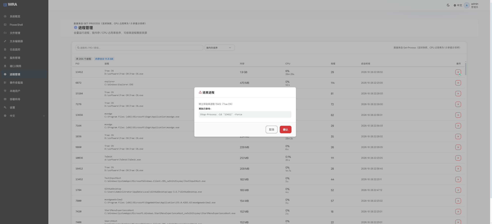

**事件查看器** —— 按日志源/级别/时间范围/关键字查询 Windows 事件日志，支持屏蔽关键字

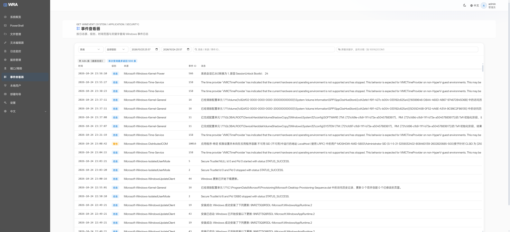

**本地用户** —— 账户状态一览，解锁 / 启用 / 重置密码（admin 专属，确认框 + 审计）

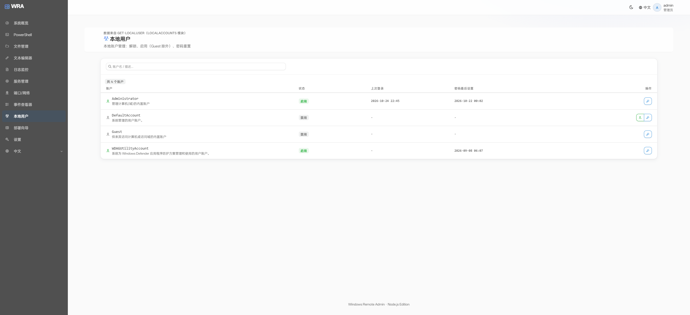

**部署向导** —— 环境检测、NSSM 服务安装说明、Windows 防火墙放行检测、GCP GCE MIG 防火墙 tag 指引，命令一键复制

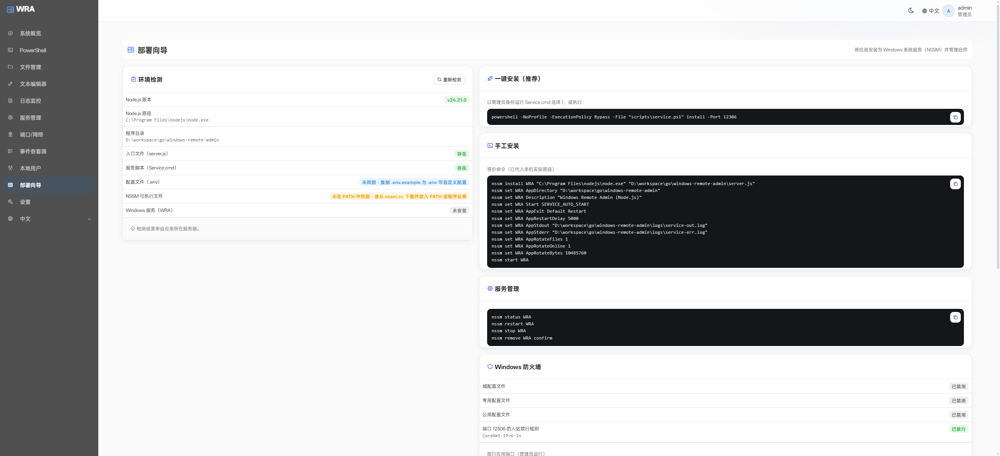

**设置** —— 快速访问目录配置，保存即时生效

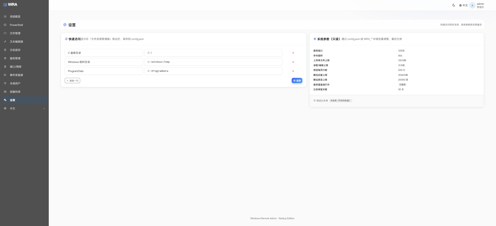

**错误兜底页** —— 404 / 500 / 403 / 429 语义化提示

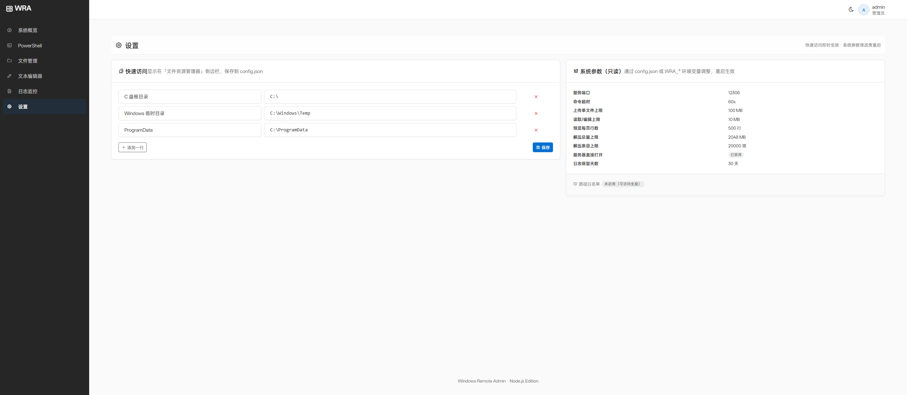

## 功能详细说明

### 系统概览 `/dashboard`

- 卡片直出：操作系统版本、CPU 使用率与型号、内存占用（已用/总量）、开机运行时间
- 本地磁盘：所有盘符容量与使用率进度条
- 内存占用 Top 10 进程表，右上角"刷新进程"手动刷新，整页自动轮询

### PowerShell 控制台 `/console`

- **连续会话**：命令在同一 PowerShell 会话中依次执行，`cd`、变量、函数、已加载模块跨命令保留；按用户名隔离会话，空闲 10 分钟自动回收，命令超时强杀后自动重建（状态重置）
- **后台长任务独占右侧面板**（自动补全已覆盖原快捷命令场景）：右侧面板仅任务列表（每条附「详情」按钮）；终端 : 任务面板 = **7:3** 布局，大屏页面容器放宽至 99%；任务列表与终端输出等高、内部滚动；终端高度/字号随视口自适应（34" 带鱼屏 ~ 15" 笔记本），并可**拖拽调节高度**（页面标题下拖拽条，localStorage 记忆，双击恢复自适应）
- 输入框支持 Enter 执行、↑↓ 翻阅命令历史，可一键清屏；输入行为内嵌终端的 textarea，**支持多行命令**（Enter 执行 / Shift+Enter 换行，自动增高，↑↓ 仅在首/末行接管历史），回显按行渲染 `PS>` / `>>` 提示符
- **命令自动补全**：输入 ≥2 个字符即弹出候选下拉（服务端提供真实 `Get-Command` 全集，进程级缓存 + 静态种子兜底），↑↓ 循环选择、Tab 接受、Esc 关闭；候选同时按前缀与包含匹配排序
- **命令历史增强**：↑↓ 按**当前输入前缀**过滤历史（↑ 逐条回溯、↓ 返回草稿）；卡片头「历史」按钮展开历史面板（最新在前），点击条目回填输入框；历史保留最近 100 条（localStorage）
- 终端采用经典 PowerShell 深蓝配色（#012456），输出区与输入行连成一体，更贴近真实控制台观感
- 超时保护：命令超过 `psTimeoutMs`（默认 60s）强制终止进程树
- 输出上限 2MB，超出自动截断并提示；显示退出码与执行耗时（毫秒）
- 命令以 Base64(UTF8) 传递并 Invoke-Expression 执行，避免中文与特殊字符乱码
- **后台长任务**：终端输出卡**底部选项条**（输入行下方：作为后台长任务运行 / 超时预算 / 脚本模式），右侧提示随状态切换——未勾选显示「直连模式：响应直接输出到终端」，勾选后显示「后台任务：点击执行提交」，脚本模式再切为「后台 .ps1 任务（无直接输出）」；勾选后点击「执行」即把**终端输入框**内容作为独立 Job 提交（每用户并发 ≤3），不占用交互会话与串行队列；输出经 SSE 实时推送到任务面板与详情窗口，运行中可随时终止（确认框 + taskkill /T /F + 审计）；超时预算默认 30 分钟，可选 10 分钟~24 小时
- **脚本模式**：勾选后终端**输出框变为约 10 行高的深色脚本编辑区**（与终端同配色，可纵向拉伸），多行 `.ps1` 内容（支持 `param()` 与多行语法）在此编辑，点「执行」以临时脚本文件方式运行（UTF-8 BOM，兼容 PS 5.1 中文），结束后自动删除；取消勾选恢复输出框
- 任务历史保留 24 小时并持久化，服务重启后遗留运行任务自动标记失败；提交/终止写审计日志，只读账号仅可查看

### 文件管理 `/files`

- **浏览**：面包屑导航 + 路径栏直达；表头可按 名称 / 大小 / 修改时间 排序
- **多选**：支持跨目录勾选（切换目录不丢选择），批量 压缩 / 打包下载
- **上传**：单文件上限 `uploadMaxMb`（默认 100MB）、单次最多 20 个文件，实时进度条
- **预览**：类型感知 —— 文本分页（每页 `previewPageLines` 行）、图片、zip 条目列表、二进制仅元数据；文本 >10MB、其他 >50MB 在服务端直接拒绝并 toast 提示
- **压缩 / 解压**：zip 打包与解压受 `extractMaxMb` / `extractMaxFiles` 上限约束，解压强制 Zip Slip 路径校验
- **收藏与快速访问**：任意目录可收藏；侧栏"快速访问"由设置页配置，"最近访问"自动记录跳转足迹
- **长任务**：压缩 / 解压 / 打包下载走按用户串行队列，SSE 实时推送任务进度，避免资源耗尽

### 文本编辑器 `/editor`

- 从文件管理"编辑"进入，或直接访问 `/editor?path=文件路径`；未带 path 显示引导空态
- 行号同步滚动、行列状态实时显示；Ctrl+S 或按钮保存
- 保存前自动生成时间戳备份（`原文件.时间戳.bak`）；支持只读模式防误改
- 仅支持文本文件，可读上限 `readMaxMb`（默认 10MB）

### 日志监控 `/logs`

- **大日志优化**：尾部读取与历史翻页均为固定 512KB 窗口按需读取（100MB / 1GB 文件内存占用恒定）；SSE 增量追加读单次 2MB、最多 4 连读自适应追赶，高频写入不滞后
- **向上翻页**："加载更早 500 行"按字节游标回溯，可一直翻到文件开头，不整读文件
- **Grep 搜索**：全文件流式扫描（单批最多 32MB，游标精确到字节，无重复无遗漏），支持匹配行前后 N 行上下文（组重叠自动合并、省略行数提示）；结果块可固定，固定后可继续搜其他关键字对照
- 扫描指定目录，按通配符（默认 `*.log*`）过滤日志文件，兼容轮转产生的 `.1` `.2` 后缀
- 关键词过滤：输入后回车刷新，匹配内容高亮标记（作用于当前展示行）
- 默认展示最后 500 行；SSE 实时追加新日志，自动跟踪新产生的文件

### 服务管理 `/services`

- **列表**：一次 CIM 查询（`Win32_Service`）展示 名称/显示名、状态、启动类型、PID、登录账户、可执行路径（悬停显示）；顶部统计徽章（总数 / 运行中 / 已停止 / 自动启动未运行）
- **搜索**：按 名称 / 显示名 / 登录账户 实时过滤（400ms 防抖）
- **操作**：启动 / 停止 / 重启 / 启动类型切换（自动 / 手动 / 禁用），操作后列表自动刷新
- **安全**：服务名白名单校验；动态值经 spawn env 注入（不拼接命令串）；所有写操作记录审计日志（操作人 / IP / 服务名 / 动作 / 结果）

### 设置 `/settings`

- 快速访问目录的增删改，保存写入 `config.json` 并即时生效（无需重启）

### 简易部署 `/deploy`

面向小版本 / 小功能更新的原地更新：上传 zip 压缩包 → 预检 → 自动备份 → 覆盖解压 → 重启即生效，admin 专属。

- **压缩包规范**（页面同步展示，不满足预检直接拒绝；一键生成请用 `npm run pack:deploy`）：
  - **必须包含**：`package.json`、`server.js`，以及代码目录 `src/` / `views/` / `public/` / `scripts/` 中至少一个
  - **可选包含**：代码目录按需携带，包内出现的目录将整体替换现有同名目录
  - **禁止包含**：`data/`、`logs/`、`backups/`、`.env*`，以及上述白名单之外的任何条目（如 `package-lock.json`、`README.md`、`*.cmd`——预检一律拒绝）
  - **不建议**：`node_modules/`（体积大且易覆盖出错，自动剥离 + 预检警告；依赖变更通过 `package.json` 对比提示，部署后手动 `npm install`）
  - 支持单层包裹目录（如 zip 内全部条目位于同一个顶层目录下，自动剥离）
  - 注意：`public/` 整体替换，vendor 静态资源（Tabler / HTMX / 图标字体）必须随包携带，否则部署后页面样式丢失（`pack:deploy` 已自动处理）
- **预检**：结构白名单校验、文件数（≤20000）与总解压体积（≤500MB）上限、Zip Slip 路径穿越防护、`package.json` 依赖对比（deps 变更需勾选确认）、node_modules 剥离警告
- **部署流程**：上传表单可填写**部署版本号**（默认取最近一次部署版本 +1，仅数字与点），确认后自动备份当前版本到 `backups/deploy-<版本号>-<自动时间戳>/`（保留最近 5 份），再移除包内携带的旧代码目录并覆盖解压
- **启动门卫自动回滚**（`src/boot-gate.js`）：部署写入 `data/deploy-pending.json` 标记，下次重启经门卫启动——启动成功清除标记转正；**首次启动失败（require 报错 / 插件注册失败 / 端口监听失败，60 秒超时未就绪同样视为失败）自动回滚到部署前备份**并退出，由 NSSM / `--watch` / 人工重新拉起旧版本；端口被占用 / 无权限（EADDRINUSE / EACCES）判定为环境问题而非版本问题，不回滚、保留部署与备份交人工处理；最多重试 2 次防循环
- **启动结果持久化**：门卫的每次裁决（转正 / 自动回滚 / 环境错误 / 放弃）落盘 `data/deploy-last-result.json`，`/deploy` 页右栏展示「上次启动结果」卡片，首次被查看时补写审计——进程外发生的自动回滚同样可追溯
- **staging 自动清理**：上传后一直未确认的部署包（`data/deploy-staging/`）超过 24 小时自动清理（启动时 + 每次打开 /deploy 页时）
- **手动回滚**：备份列表一键回滚到任一历史版本（确认框 + 审计）
- **审计**：上传部署包 / 执行部署 / 回滚全部记录审计日志
- ⚠️ **风险提示**（页面常驻横幅）：部署有风险，请先在 low environment 进行多次验证再上 production

### 环境变量管理 `/env`

Machine / User 两个作用域的系统环境变量管理（读写走 `[Environment]::SetEnvironmentVariable`，变量名与值均经 spawn env 注入，绝不拼接进命令串）。

- **浏览**：作用域 Tab 切换、关键字搜索（名称即搜即显）、值长度列；新进程级生效（已运行进程需重启感知）
- **新增 / 编辑**：变量名正则校验（`[A-Za-z0-9_.\-\s()]`），值上限 32000 字符；编辑敏感变量时按需调 `/env/reveal` 回填原值
- **关键变量保护**：30 个系统关键变量（Path / PathExt / ComSpec / OS / SystemRoot / windir 等）禁止删除——UI 删除按钮置灰（换锁形图标）+ 后端 400 双重拦截
- **敏感值打码**：名称含 pass / pwd / token / secret / key / credential / apikey 的变量值默认显示 `••••••••`，查看走 `/env/reveal`（admin 专属 + 审计「查看敏感环境变量」）
- **审计**：保存 / 删除 / reveal 全部审计

### 证书管理 `/certs`

LocalMachine 计算机证书存储区浏览与导出（仅 LocalMachine，不涉 CurrentUser）。

- **浏览**：六大常用存储区切换（My / WebHosting / Root / CA / TrustedPeople / TrustedPublisher）、状态筛选（已过期 / 30 天内到期 / 正常，色块徽章）+ 关键字搜索（主题 / 颁发者 / SAN / 指纹）
- **列表信息**：主题 / 颁发者（CN 提取）、指纹（SHA-1，悬停显示完整值）、有效期与剩余天数、SAN（截断显示）、私钥标识
- **详情弹窗**：完整主题 / 颁发者、有效期、指纹、序列号、签名算法、密钥位长、EKU 用途、SAN 全量
- **上传证书**（admin + 审计）：`.cer/.crt/.pem` 导入公钥（PEM 文本自动转 DER，无需密码）；`.pfx/.p12` 含私钥需填写导入密码（密码 env 注入不落日志）；文件落临时目录导入后即删
- **导出**（admin + 审计）：`.cer` DER 公钥、`.pem` PEM 公钥文本直接下载；`.pfx` 走一次性下载 token（5 分钟 TTL）+ 随机密码，密码仅通过响应头 / Toast 展示一次，不落日志不落审计
- **删除**（admin + 审计）：确认框预览 `Remove-Item Cert:\LocalMachine\<存储区>\<指纹>` 命令
- 动态值（指纹 / 密码 / 存储区）全部 spawn env 注入；列表与详情全员只读可见

### 全局

- 登录按 IP 限流（5 次/分钟）；全站 CSRF 校验；会话 Cookie HttpOnly + SameSite=Lax（24 小时）
- 所有写操作记录审计日志（操作人 / IP / 参数 / 结果）
- 顶栏支持亮 / 暗主题切换（记忆偏好、无闪烁初始化）
- **多语言**：默认英文，支持简体中文，通过侧栏"语言"菜单或登录页链接切换（`/lang/en`、`/lang/zh-CN`），偏好写入 Cookie `wra_lang` 保留 1 年；覆盖全部页面 UI 文案、确认框、Toast 与服务端固定提示（PowerShell 命令、路径等动态数据不翻译；审计日志保持中文记录）
- 错误兜底页覆盖 404 / 500 / 403 / 429，HTMX 请求弹 Toast、浏览器导航渲染整页（含多语言）

## 配置说明

默认配置在 `config.default.json`，可在同目录创建 `config.json` 覆盖（设置页保存的快速访问会自动写入 `config.json`）：

| 配置项 | 默认值 | 说明 |
|--------|--------|------|
| `port` | `12306` | 服务监听端口 |
| `psTimeoutMs` | `60000` | PowerShell 命令超时（毫秒） |
| `uploadMaxMb` | `100` | 单文件上传上限（MB） |
| `readMaxMb` | `10` | 编辑器可读文件上限（MB） |
| `previewPageLines` | `500` | 文本预览每页行数 |
| `extractMaxMb` | `2048` | zip 解压总解压上限（MB） |
| `extractMaxFiles` | `20000` | zip 解压条目数上限 |
| `enableServerOpen` | `false` | 是否允许"服务器打开"（Start-Process），默认禁用 |
| `pathWhitelist` | `[]` | 文件操作路径白名单；为空表示不限制 |
| `quickAccess` | 内置 3 项 | 侧栏快速访问目录 |
| `logRetentionDays` | `30` | 日志保留天数 |

环境变量同样支持写在程序根目录的 `.env` 文件中（参考 `.env.example`，复制为 `.env` 即生效）：`npm start`、`Run.cmd`、`npm run dev` 与 NSSM 服务启动时都会自动加载程序目录下的 `.env`，与启动时所在目录无关；`.env` 中已存在的同名系统环境变量不会被覆盖（外部注入优先）。也可用环境变量直接覆盖：`WRA_PORT`、`WRA_PS_TIMEOUT`、`WRA_UPLOAD_MAX_MB`、`WRA_PATH_WHITELIST`（`;` 分隔）、`WRA_SESSION_SECRET` 等。

### 账号管理

账号存于 `data/entitlement.csv`（`username,password_hash[,role]`）。新账号可先写入一行明文密码 `user,123456`，服务启动时自动哈希迁移。忘记密码时删除对应用户行重启即可，或恢复为明文格式让系统重新哈希。

**只读账号**：第三列写 `readonly` 即创建（如 `viewer,123456,readonly`），登录后不可执行 PowerShell、不可上传，文件页只保留浏览 / 预览 / 下载 / 收藏，服务管理与设置仅可查看，文本编辑器强制只读模式；所有写接口服务端双重拦截（403）。第三列缺省或写其他值均为管理员。

## 目录结构

```
windows-remote-admin/
├─ Run.cmd / Build.cmd / Pack.cmd  启动 / 构建 / 打包脚本
├─ Service.cmd             NSSM 服务管理（双击菜单，安装/卸载/启停/状态）
├─ server.js               入口
├─ config.default.json     默认配置
├─ config.json             本机覆盖配置（可选，自动生成）
├─ src/
│  ├─ app.js               Fastify 应用工厂（插件/钩子/错误处理）
│  ├─ config.js            配置加载与会话密钥
│  ├─ logging.js           pino 三流日志（app/audit/access）
│  ├─ routes/              auth/pages/dashboard/console/files/editor/logs/settings
│  ├─ services/            entitlement/powershell/filesystem/archive/systeminfo
│  └─ hooks/               认证、审计
├─ views/                  EJS 模板（layouts/pages/partials）
├─ public/                 本地 CSS/JS（静态资源由 copy-assets.js 从 node_modules 复制）
├─ scripts/                copy-assets.js 静态资源复制、pack.js 分发打包
├─ screencap/              功能截图（README"界面预览"引用）
├─ dist/                   npm run pack:code 产物输出（不入版本库）
├─ data/                   entitlement.csv、.session-key（勿入版本库）
└─ logs/                   app.log / audit.log / access.log（按天轮转，保留 30 天）
```

## 安全注意事项

- **务必修改默认密码**，并将服务部署在可信网络中；本工具可执行任意 PowerShell 命令，暴露公网风险极高
- 所有写操作均记录审计日志（`logs/audit.log`），可追溯操作人、IP、参数
- 登录接口按 IP 限流（5 次/分钟）；全站启用 CSRF 校验；会话 Cookie 为 HttpOnly + SameSite=Lax
- 建议配置 `pathWhitelist` 限制文件操作范围；保持 `enableServerOpen` 关闭除非确有需要
- 密码使用 bcrypt 哈希存储，不保留明文

## 安全审查（Security Review）建议与结果

以下为项目自查的安全审查清单：左侧为已落地并实测验证的机制（结果），供部署前对照；随后给出上线加固建议，也欢迎社区补充更多审查视角。

### 已落地并验证的安全机制（结果）

| 审查项 | 结果 |
|--------|------|
| 认证与会话 | 全站路由强制登录；会话 Cookie HttpOnly + SameSite=Lax（24 小时），会话密钥支持 `WRA_SESSION_SECRET` 环境变量注入 |
| 登录防爆破 | 登录接口按 IP 限流（5 次/分钟），超出返回 429 语义化错误页 |
| CSRF 防护 | 全部写请求校验 CSRF Token（`@fastify/csrf-protection`），HTMX 请求统一携带 `X-CSRF-Token` 头 |
| 命令注入 | 动态值一律经 spawn env 注入 PowerShell（`$env:WRA_*` 引用），从不拼接进命令串；服务名/任务名/PID 等另加白名单正则校验 |
| 路径穿越 | `resolveUserPath` 加固：长度上限 1000、禁控制字符 / UNC 路径 / NTFS ADS（第二个冒号）/ Windows 非法字符 / 保留设备名；可叠加 `pathWhitelist` 白名单 |
| 恶意压缩包 | zip 解压强制 Zip Slip 路径校验 + 总解压量 / 条目数上限；长任务按用户串行队列防资源耗尽 |
| 权限分级 | readonly 角色写操作前后端双重拦截（UI 隐藏 + 服务端 403）；系统关键进程（PID 0/4/8）与内置 Guest 账户禁止操作 |
| 审计追溯 | 仅非只读行为写审计日志（上传 / 下载 / 保存 / 删除 / 各类管理操作，操作人 / IP / 参数 / 结果），敏感值（密码等）打码不落日志；目录浏览、日志查看等纯查看操作与未登录的页面访问不写审计（访问日志仍全量记录），避免审计噪音 |
| 密码存储 | bcrypt 哈希存储，历史明文启动时自动迁移哈希；重置密码经 env 注入执行，不进命令串与日志 |
| 输入 / 输出边界 | PowerShell 输出 2MB 截断 + 超时强杀进程树；上传 / 预览 / 编辑均有大小与类型限制（服务端先行拒绝） |
| 供应链与外带 | Tabler / HTMX / 图标字体全部本地化，运行期零外网请求，收窄供应链攻击与数据外带面 |

### 上线加固建议（建议）

- **网络层**：切勿直接暴露公网。置于 Nginx / Caddy 反代后终结 HTTPS，并在代理或防火墙做来源 IP 白名单；GCP 建议 MIG 网络 tag + 防火墙规则仅放行可信网段（健康检查网段除外）
- **凭证**：首次登录立即修改默认密码；生产显式设置 `WRA_SESSION_SECRET`（不依赖自动生成）并定期轮换
- **最小权限**：配置 `pathWhitelist` 收敛文件操作范围；保持 `enableServerOpen=false`；日常查看类工作分配 readonly 账号，写操作留 admin 专人使用
- **审计运营**：定期备份并巡检 `logs/audit.log`，可配合事件查看器 `/events` 交叉核账；日志目录纳入备份与保留策略
- **依赖与运行时**：使用 Node.js LTS 并定期 `npm audit` 升级依赖，关注 Fastify 安全公告
- **纵深防御**：NSSM 服务以专用低权限账户运行（`nssm set WRA ObjectName`）而非 LocalSystem；主机保持 Windows 更新与安全基线

## 参与贡献

项目已在 GCP 线上环境长期运行，更多实用功能持续更新中。欢迎通过 Issue 提出使用建议与新功能需求，或直接提交 PR：

- 提交前请运行 `Build.cmd`（依赖同步 + 全量语法检查）确保通过
- 新增写操作请遵循项目惯例：**二次确认框（预览将执行的 PowerShell 命令）+ 独立审计日志 + readonly 角色拦截**，三者缺一不可
- 动态值一律 spawn env 注入（`$env:WRA_*`），禁止拼接命令串；文件操作必须经 `resolveUserPath` 校验
- UI 文案需补充中英双语（`src/i18n-parts/`），涉及界面效果请附截图；README 更新日志请同步一行

## 以 Windows 服务运行（NSSM，可选）

用 [NSSM](https://nssm.cc/)（Non-Sucking Service Manager）把服务注册为系统服务，实现开机自启、崩溃自动拉起。首次部署先运行一次 `Build.cmd`（安装依赖并复制静态资源），把 `nssm.exe` 放入 PATH 或程序目录，然后**以管理员身份**运行 `Service.cmd` 选菜单操作，或执行：

```bat
rem 安装（默认服务名 WRA；-Port 可选，写入服务环境变量覆盖端口）
powershell -NoProfile -ExecutionPolicy Bypass -File scripts\service.ps1 install -Port 12306

rem 卸载 / 启停 / 状态
powershell -NoProfile -ExecutionPolicy Bypass -File scripts\service.ps1 uninstall
powershell -NoProfile -ExecutionPolicy Bypass -File scripts\service.ps1 status
```

安装脚本自动完成：`SERVICE_AUTO_START` 开机自启、进程意外退出 5 秒后自动重启、stdout/stderr 重定向到 `logs\service-*.log`（10MB 轮转，仅兜底启动崩溃输出——应用日志已由 pino-roll 写入 `logs\`）。运行参数也可用 `-ExtraEnv "K=V"` 追加。

手工命令方式（等价）：

```bat
rem 安装服务：nssm install <服务名> <node.exe 路径> <server.js 路径>
nssm install WRA "C:\Program Files\nodejs\node.exe" "D:\app\windows-remote-admin\server.js"

nssm set WRA AppDirectory "D:\app\windows-remote-admin"
nssm set WRA Description "Windows Remote Admin (Node.js)"
nssm set WRA Start SERVICE_AUTO_START

rem 进程意外退出时自动重启（可选：设置重启延迟毫秒数）
nssm set WRA AppExit Default Restart
nssm set WRA AppRestartDelay 5000

rem 兜底日志：仅捕获启动崩溃等进程级输出
rem 应用自身日志已由 pino-roll 写入 logs\ 并按天轮转，两者互不影响
nssm set WRA AppStdout "D:\app\windows-remote-admin\logs\service-out.log"
nssm set WRA AppStderr "D:\app\windows-remote-admin\logs\service-err.log"
nssm set WRA AppRotateFiles 1
nssm set WRA AppRotateOnline 1
nssm set WRA AppRotateBytes 10485760

rem 可选：用环境变量覆盖配置（变量名见"配置说明"）
nssm set WRA AppEnvironmentExtra WRA_PORT=12306 WRA_PS_TIMEOUT=60000

nssm start WRA
```

常用管理命令（同样以管理员身份）：

```bat
nssm status WRA
nssm restart WRA
nssm stop WRA
nssm remove WRA confirm
```

> 提示：`node.exe` 与程序目录路径含空格时务必带引号；服务默认以 LocalSystem 运行，文件操作权限继承该账户，如需限定可 `nssm set WRA ObjectName <域\用户> <密码>`。

## 反向代理（HTTPS / SSE）

建议置于 Nginx / Caddy 等反代之后终结 HTTPS。SSE（日志实时监控）需要关闭代理缓冲：

```nginx
location / {
    proxy_pass http://127.0.0.1:12306;
    proxy_http_version 1.1;
    proxy_set_header Host $host;
    proxy_set_header X-Forwarded-For $proxy_add_x_forwarded_for;
    proxy_buffering off;          # SSE 必需
    proxy_read_timeout 3600s;     # 长连接
}
```
