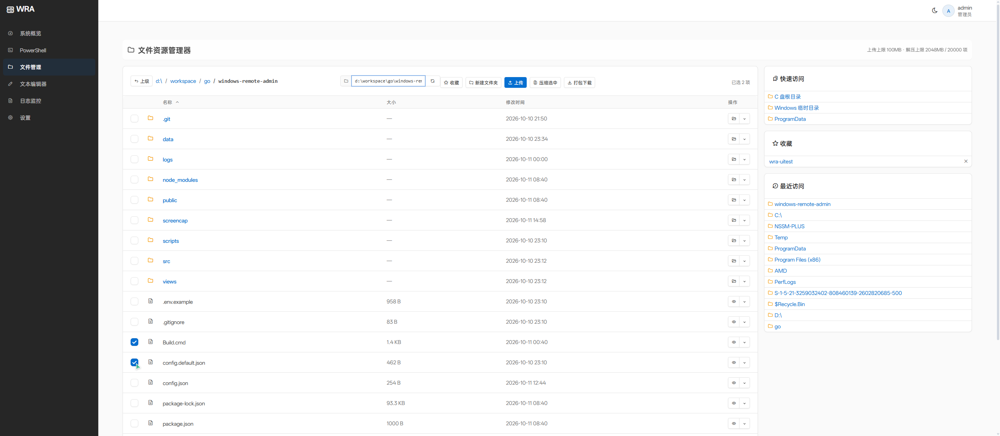
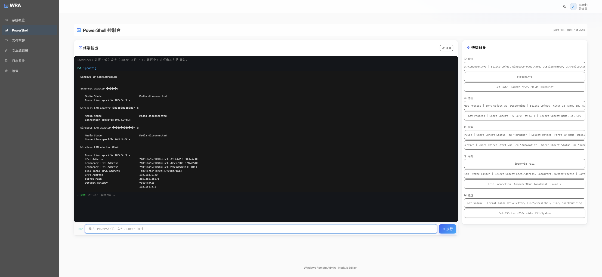
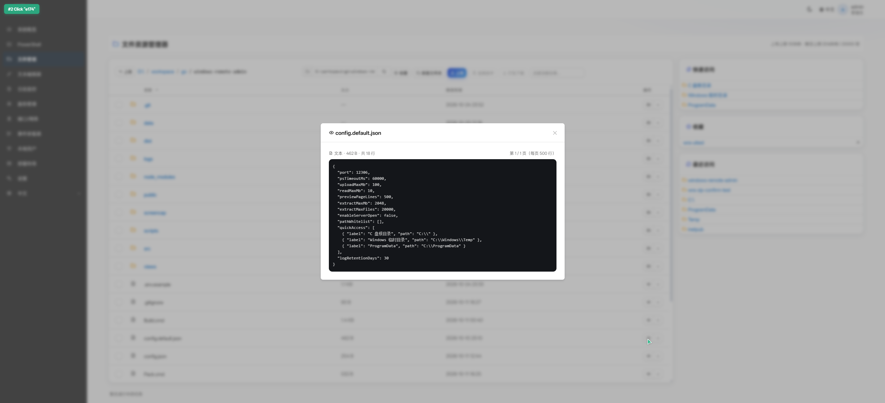
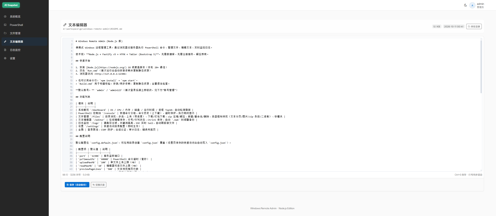
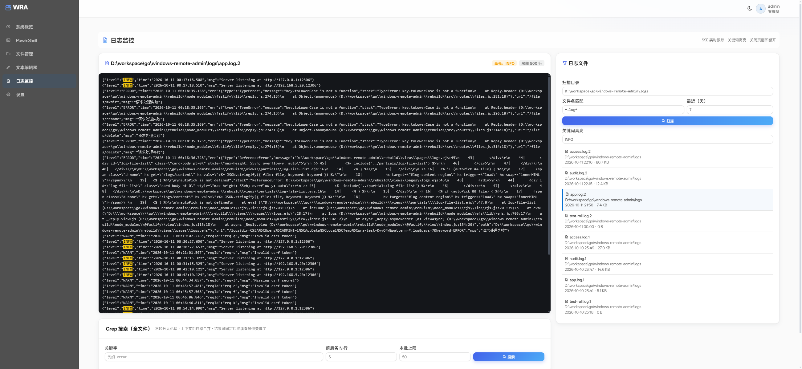
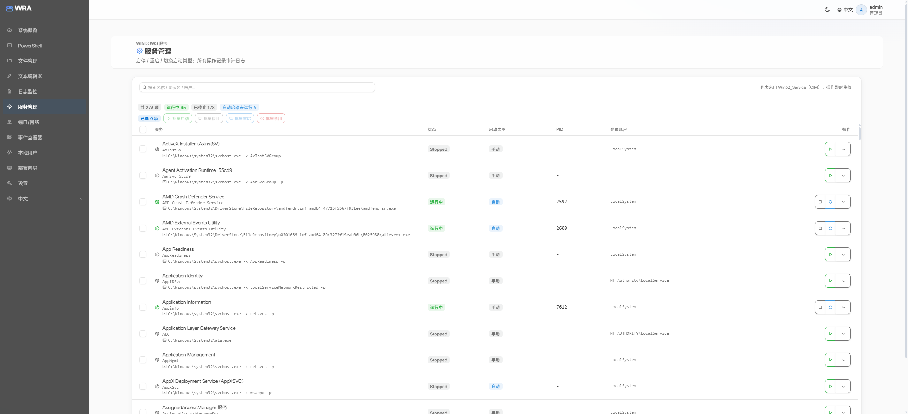
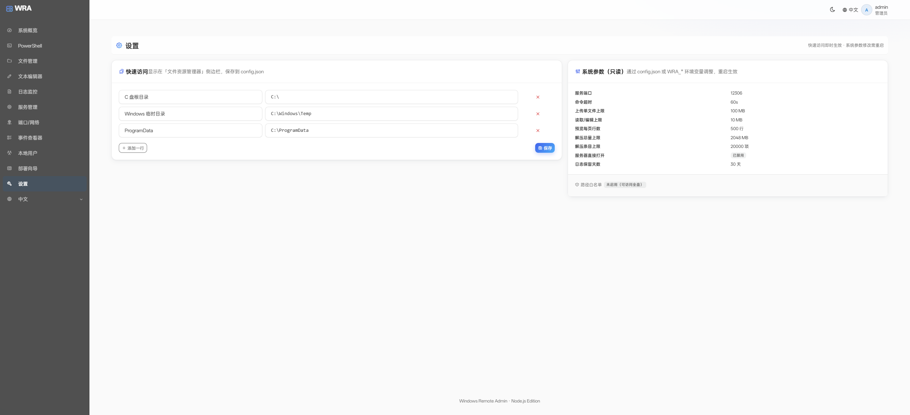
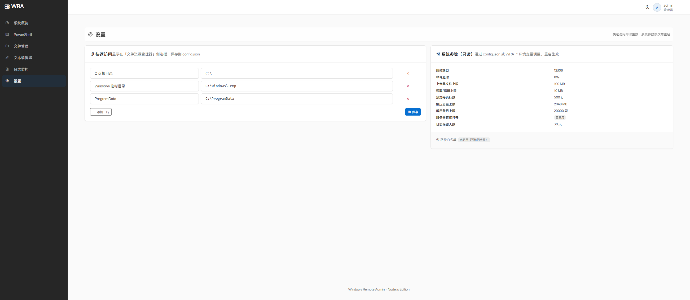

# Windows Remote Admin (Node.js 版)

便携式 Windows 远程管理工具：通过浏览器对服务器执行 PowerShell 命令、管理文件、编辑文本、实时监控日志。

技术栈：**Node.js + Fastify v5 + HTMX + Tabler (Bootstrap 5)**，无需数据库、无需注册服务，解压即用。

## 为什么从 Go 重构为 Node.js

本项目最初为 Go 实现（单二进制 + embed 静态资源）。随着文件资源管理器、类型感知预览、SSE 任务进度等**重前端交互**功能不断叠加，模板与静态资源改动越来越频繁，Go 版每次调整都要重新编译再分发，内网迭代链路偏长。重构后的主要取舍：

| 维度 | Go 版 | Node.js 版（当前） |
|------|-------|-------------------|
| 迭代效率 | 改模板/静态资源需重新编译 | 改 EJS / CSS / JS 保存即生效，零构建步骤 |
| 会话与安全插件 | 需自行拼装 | Fastify 官方插件开箱即用（secure-session / csrf-protection / multipart / rate-limit / static / view） |
| 模板与前端生态 | html/template 手写布局 | EJS + HTMX（含 OOB 局部更新）+ Tabler 本地化，服务端渲染心智统一 |
| 日志方案 | 自行封装 | pino 三流（app / audit / access）+ pino-roll 按天轮转 |
| 部署形态 | 单二进制 | 目录分发：Run.cmd 自动装依赖、复制资源；可用 NSSM 注册系统服务 |
| 性能 | 高 | 本工具为"单管理员、低并发"场景，Node 性能绰绰有余 |

一句话总结：**放弃"单二进制"，换来"改完即生效 + 零构建"的迭代体验**——对功能仍在快速演进的内网管理工具，这是更划算的交换。

## 快速开始

1. 安装 [Node.js](https://nodejs.org/) 18 或更高版本（本机 20+ 最佳）
2. 双击 `Run.cmd`（首次运行会自动安装依赖并复制静态资源）
3. 浏览器访问 <http://127.0.0.1:12306>

> 也可以用命令行：`npm install` → `npm start`。
> `Build.cmd` 用于构建校验：安装/同步依赖、复制静态资源、全量语法检查。
> `Pack.cmd`（或 `npm run pack:code`）用于生成分发压缩包，见下方"分发打包"。

## 分发打包（code & web only）

面向"源码 + 页面"的轻量分发场景，产物不携带依赖与运行数据：

```bash
npm run pack:code    # 或双击 Pack.cmd
```

- 产物：`dist/windows-remote-admin-code-web-v<版本>.zip`（约 100 KB）
- **包含**：`server.js`、`package.json` / `package-lock.json`、`config.default.json`、`.env.example`、`README.md`、`Run.cmd` / `Build.cmd` / `Pack.cmd`、`src/`、`views/`、`scripts/`、`public/` 本地文件（app.css / app.js）
- **不包含**：`node_modules`、vendor 静态资源（Tabler / HTMX / 图标字体，由 postinstall 自动复制）、`logs/`、`data/`、`screencap/`、`dist/`、本机 `config.json`
- 接收方解压后双击 `Run.cmd` 即可：首次运行自动 `npm install`（postinstall 同步静态资源）并启动服务

**默认账号：** `admin` / `admin123`（首次登录后请立即修改，见下方"账号管理"）

## 功能列表

| 模块 | 说明 |
|------|------|
| 系统概览 `/dashboard` | OS / CPU / 内存 / 磁盘 / 运行时间 / 进程 Top10，自动轮询刷新 |
| PowerShell 控制台 `/console` | 连续会话（cd / 变量跨命令保留）、快捷命令分组、命令历史（上下键）、超时保护、执行耗时显示 |
| 文件管理 `/files` | 目录浏览、多选、上传（带进度）、下载/打包下载、zip 压缩/解压、新建/重命名/删除、类型感知预览（文本分页/图片/zip 条目/二进制）、收藏夹 |
| 文本编辑器 `/editor` | 在线编辑保存、行号/行列状态、Ctrl+S 保存、自动 `.bak` 时间戳备份 |
| 日志监控 `/logs` | 通配符过滤、关键词高亮、SSE 实时 tail、自动跟踪新文件 |
| 服务管理 `/services` | 服务列表/搜索、单服务与批量启停/重启/禁用（复选框多选，单批上限 20）、启动类型切换，全部操作弹确认框（预览将执行的 PowerShell 命令）并逐条审计，只读账号仅可查看 |
| 端口/网络 `/net` | TCP/UDP 连接列表（本地/远程地址、状态、PID、占用进程完整命令行），状态筛选 + 关键字搜索（端口/PID/进程/IP/命令行），admin 可结束占用进程释放端口（确认框预览 `Stop-Process` 命令 + 审计），系统关键进程（PID 0/4/8）拒绝操作，只读账号仅可查看 |
| 事件查看器 `/events` | Windows 事件日志查询（System/Application/Security），按级别（严重/错误/警告/信息）与起止日期时间筛选，关键字搜索消息/来源/事件 ID，支持屏蔽关键字（逗号分隔，隐藏高频噪音事件），最新在前，单次最多 500 条，只读功能 |
| 设置 `/settings` | 快速访问目录配置（即时生效） |
| 全局 | 登录限流、CSRF 防护、会话认证、审计日志、错误兜底页、多语言（英文/简体中文） |

## 界面预览

**登录页**（默认账号 `admin / admin123`）


**系统概览** —— OS / CPU / 内存 / 磁盘 / 运行时间 / 进程 Top10，自动轮询刷新



**PowerShell 控制台** —— 快捷命令分组、命令历史、超时保护、执行耗时显示



**文件资源管理器** —— 目录浏览、多选批量操作、上传/下载、收藏夹与快速访问


**类型感知文件预览** —— 文本分页 / 图片 / zip 条目 / 二进制元数据，超限与失败直接提示



**文本编辑器** —— 行号与行列状态、Ctrl+S 保存、自动 `.bak` 时间戳备份



**日志监控** —— 通配符过滤、关键词高亮、SSE 实时 tail



**服务管理** —— 启停 / 重启 / 启动类型切换 / 批量操作，确认框预览命令、操作即审计

**端口/网络** —— TCP/UDP 连接与占用进程、结束进程释放端口，确认框 + 审计

**事件查看器** —— 按日志源/级别/时间范围/关键字查询 Windows 事件日志



**设置** —— 快速访问目录配置，保存即时生效



**错误兜底页** —— 404 / 500 / 403 / 429 语义化提示



## 功能详细说明

### 系统概览 `/dashboard`

- 卡片直出：操作系统版本、CPU 使用率与型号、内存占用（已用/总量）、开机运行时间
- 本地磁盘：所有盘符容量与使用率进度条
- 内存占用 Top 10 进程表，右上角"刷新进程"手动刷新，整页自动轮询

### PowerShell 控制台 `/console`

- **连续会话**：命令在同一 PowerShell 会话中依次执行，`cd`、变量、函数、已加载模块跨命令保留；按用户名隔离会话，空闲 10 分钟自动回收，命令超时强杀后自动重建（状态重置）
- 快捷命令按 **系统信息 / 进程 / 服务 / 网络 / 磁盘** 分组，点击即执行
- 输入框支持 Enter 执行、↑↓ 翻阅命令历史，可一键清屏
- 超时保护：命令超过 `psTimeoutMs`（默认 60s）强制终止进程树
- 输出上限 2MB，超出自动截断并提示；显示退出码与执行耗时（毫秒）
- 命令以 Base64(UTF8) 传递并 Invoke-Expression 执行，避免中文与特殊字符乱码

### 文件管理 `/files`

- **浏览**：面包屑导航 + 路径栏直达；表头可按 名称 / 大小 / 修改时间 排序
- **多选**：支持跨目录勾选（切换目录不丢选择），批量 压缩 / 打包下载
- **上传**：单文件上限 `uploadMaxMb`（默认 100MB）、单次最多 20 个文件，实时进度条
- **预览**：类型感知 —— 文本分页（每页 `previewPageLines` 行）、图片、zip 条目列表、二进制仅元数据；文本 >10MB、其他 >50MB 在服务端直接拒绝并 toast 提示
- **压缩 / 解压**：zip 打包与解压受 `extractMaxMb` / `extractMaxFiles` 上限约束，解压强制 Zip Slip 路径校验
- **收藏与快速访问**：任意目录可收藏；侧栏"快速访问"由设置页配置，"最近访问"自动记录跳转足迹
- **长任务**：压缩 / 解压 / 打包下载走按用户串行队列，SSE 实时推送任务进度，避免资源耗尽

### 文本编辑器 `/editor`

- 从文件管理"编辑"进入，或直接访问 `/editor?path=文件路径`；未带 path 显示引导空态
- 行号同步滚动、行列状态实时显示；Ctrl+S 或按钮保存
- 保存前自动生成时间戳备份（`原文件.时间戳.bak`）；支持只读模式防误改
- 仅支持文本文件，可读上限 `readMaxMb`（默认 10MB）

### 日志监控 `/logs`

- **大日志优化**：尾部读取与历史翻页均为固定 512KB 窗口按需读取（100MB / 1GB 文件内存占用恒定）；SSE 增量追加读单次 2MB、最多 4 连读自适应追赶，高频写入不滞后
- **向上翻页**："加载更早 500 行"按字节游标回溯，可一直翻到文件开头，不整读文件
- **Grep 搜索**：全文件流式扫描（单批最多 32MB，游标精确到字节，无重复无遗漏），支持匹配行前后 N 行上下文（组重叠自动合并、省略行数提示）；结果块可固定，固定后可继续搜其他关键字对照
- 扫描指定目录，按通配符（默认 `*.log*`）过滤日志文件，兼容轮转产生的 `.1` `.2` 后缀
- 关键词过滤：输入后回车刷新，匹配内容高亮标记（作用于当前展示行）
- 默认展示最后 500 行；SSE 实时追加新日志，自动跟踪新产生的文件

### 服务管理 `/services`

- **列表**：一次 CIM 查询（`Win32_Service`）展示 名称/显示名、状态、启动类型、PID、登录账户、可执行路径（悬停显示）；顶部统计徽章（总数 / 运行中 / 已停止 / 自动启动未运行）
- **搜索**：按 名称 / 显示名 / 登录账户 实时过滤（400ms 防抖）
- **操作**：启动 / 停止 / 重启 / 启动类型切换（自动 / 手动 / 禁用），操作后列表自动刷新
- **安全**：服务名白名单校验；动态值经 spawn env 注入（不拼接命令串）；所有写操作记录审计日志（操作人 / IP / 服务名 / 动作 / 结果）

### 设置 `/settings`

- 快速访问目录的增删改，保存写入 `config.json` 并即时生效（无需重启）

### 全局

- 登录按 IP 限流（5 次/分钟）；全站 CSRF 校验；会话 Cookie HttpOnly + SameSite=Lax（24 小时）
- 所有写操作记录审计日志（操作人 / IP / 参数 / 结果）
- 顶栏支持亮 / 暗主题切换（记忆偏好、无闪烁初始化）
- **多语言**：默认英文，支持简体中文，通过侧栏"语言"菜单或登录页链接切换（`/lang/en`、`/lang/zh-CN`），偏好写入 Cookie `wra_lang` 保留 1 年；覆盖全部页面 UI 文案、确认框、Toast 与服务端固定提示（PowerShell 命令、路径等动态数据不翻译；审计日志保持中文记录）
- 错误兜底页覆盖 404 / 500 / 403 / 429，HTMX 请求弹 Toast、浏览器导航渲染整页（含多语言）

## 配置说明

默认配置在 `config.default.json`，可在同目录创建 `config.json` 覆盖（设置页保存的快速访问会自动写入 `config.json`）：

| 配置项 | 默认值 | 说明 |
|--------|--------|------|
| `port` | `12306` | 服务监听端口 |
| `psTimeoutMs` | `60000` | PowerShell 命令超时（毫秒） |
| `uploadMaxMb` | `100` | 单文件上传上限（MB） |
| `readMaxMb` | `10` | 编辑器可读文件上限（MB） |
| `previewPageLines` | `500` | 文本预览每页行数 |
| `extractMaxMb` | `2048` | zip 解压总解压上限（MB） |
| `extractMaxFiles` | `20000` | zip 解压条目数上限 |
| `enableServerOpen` | `false` | 是否允许"服务器打开"（Start-Process），默认禁用 |
| `pathWhitelist` | `[]` | 文件操作路径白名单；为空表示不限制 |
| `quickAccess` | 内置 3 项 | 侧栏快速访问目录 |
| `logRetentionDays` | `30` | 日志保留天数 |

也支持环境变量覆盖：`WRA_PORT`、`WRA_PS_TIMEOUT`、`WRA_UPLOAD_MAX_MB`、`WRA_PATH_WHITELIST`（`;` 分隔）、`WRA_SESSION_SECRET` 等。

### 账号管理

账号存于 `data/entitlement.csv`（`username,password_hash[,role]`）。新账号可先写入一行明文密码 `user,123456`，服务启动时自动哈希迁移。忘记密码时删除对应用户行重启即可，或恢复为明文格式让系统重新哈希。

**只读账号**：第三列写 `readonly` 即创建（如 `viewer,123456,readonly`），登录后不可执行 PowerShell、不可上传，文件页只保留浏览 / 预览 / 下载 / 收藏，服务管理与设置仅可查看，文本编辑器强制只读模式；所有写接口服务端双重拦截（403）。第三列缺省或写其他值均为管理员。

## 目录结构

```
windows-remote-admin/
├─ Run.cmd / Build.cmd / Pack.cmd  启动 / 构建 / 打包脚本
├─ server.js               入口
├─ config.default.json     默认配置
├─ config.json             本机覆盖配置（可选，自动生成）
├─ src/
│  ├─ app.js               Fastify 应用工厂（插件/钩子/错误处理）
│  ├─ config.js            配置加载与会话密钥
│  ├─ logging.js           pino 三流日志（app/audit/access）
│  ├─ routes/              auth/pages/dashboard/console/files/editor/logs/settings
│  ├─ services/            entitlement/powershell/filesystem/archive/systeminfo
│  └─ hooks/               认证、审计
├─ views/                  EJS 模板（layouts/pages/partials）
├─ public/                 本地 CSS/JS（静态资源由 copy-assets.js 从 node_modules 复制）
├─ scripts/                copy-assets.js 静态资源复制、pack.js 分发打包
├─ screencap/              功能截图（README"界面预览"引用）
├─ dist/                   npm run pack:code 产物输出（不入版本库）
├─ data/                   entitlement.csv、.session-key（勿入版本库）
└─ logs/                   app.log / audit.log / access.log（按天轮转，保留 30 天）
```

## 安全注意事项

- **务必修改默认密码**，并将服务部署在可信网络中；本工具可执行任意 PowerShell 命令，暴露公网风险极高
- 所有写操作均记录审计日志（`logs/audit.log`），可追溯操作人、IP、参数
- 登录接口按 IP 限流（5 次/分钟）；全站启用 CSRF 校验；会话 Cookie 为 HttpOnly + SameSite=Lax
- 建议配置 `pathWhitelist` 限制文件操作范围；保持 `enableServerOpen` 关闭除非确有需要
- 密码使用 bcrypt 哈希存储，不保留明文

## 以 Windows 服务运行（NSSM，可选）

用 [NSSM](https://nssm.cc/)（Non-Sucking Service Manager）把服务注册为系统服务，实现开机自启、崩溃自动拉起。首次部署先运行一次 `Build.cmd`（安装依赖并复制静态资源），然后**以管理员身份**执行：

```bat
rem 安装服务：nssm install <服务名> <node.exe 路径> <server.js 路径>
nssm install WRA "C:\Program Files\nodejs\node.exe" "D:\app\windows-remote-admin\server.js"

nssm set WRA AppDirectory "D:\app\windows-remote-admin"
nssm set WRA Description "Windows Remote Admin (Node.js)"
nssm set WRA Start SERVICE_AUTO_START

rem 进程意外退出时自动重启（可选：设置重启延迟毫秒数）
nssm set WRA AppExit Default Restart
nssm set WRA AppRestartDelay 5000

rem 兜底日志：仅捕获启动崩溃等进程级输出
rem 应用自身日志已由 pino-roll 写入 logs\ 并按天轮转，两者互不影响
nssm set WRA AppStdout "D:\app\windows-remote-admin\logs\service-out.log"
nssm set WRA AppStderr "D:\app\windows-remote-admin\logs\service-err.log"
nssm set WRA AppRotateFiles 1
nssm set WRA AppRotateOnline 1
nssm set WRA AppRotateBytes 10485760

rem 可选：用环境变量覆盖配置（变量名见"配置说明"）
nssm set WRA AppEnvironmentExtra WRA_PORT=12306 WRA_PS_TIMEOUT=60000

nssm start WRA
```

常用管理命令（同样以管理员身份）：

```bat
nssm status WRA
nssm restart WRA
nssm stop WRA
nssm remove WRA confirm
```

> 提示：`node.exe` 与程序目录路径含空格时务必带引号；服务默认以 LocalSystem 运行，文件操作权限继承该账户，如需限定可 `nssm set WRA ObjectName <域\用户> <密码>`。

## 反向代理（HTTPS / SSE）

建议置于 Nginx / Caddy 等反代之后终结 HTTPS。SSE（日志实时监控）需要关闭代理缓冲：

```nginx
location / {
    proxy_pass http://127.0.0.1:12306;
    proxy_http_version 1.1;
    proxy_set_header Host $host;
    proxy_set_header X-Forwarded-For $proxy_add_x_forwarded_for;
    proxy_buffering off;          # SSE 必需
    proxy_read_timeout 3600s;     # 长连接
}
```
